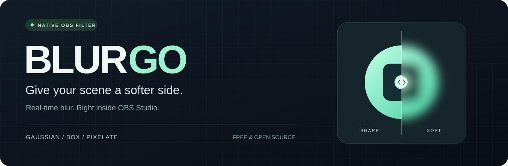
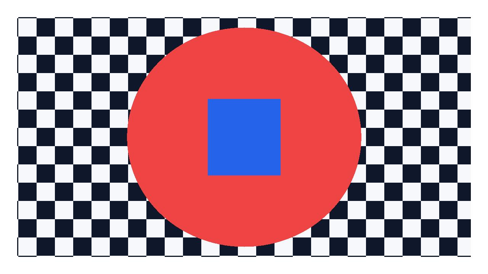
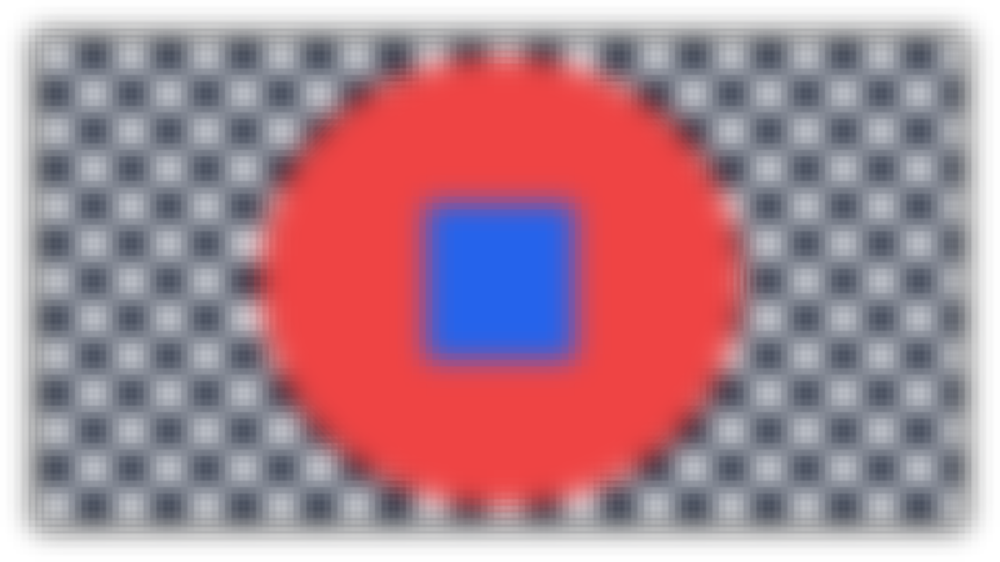
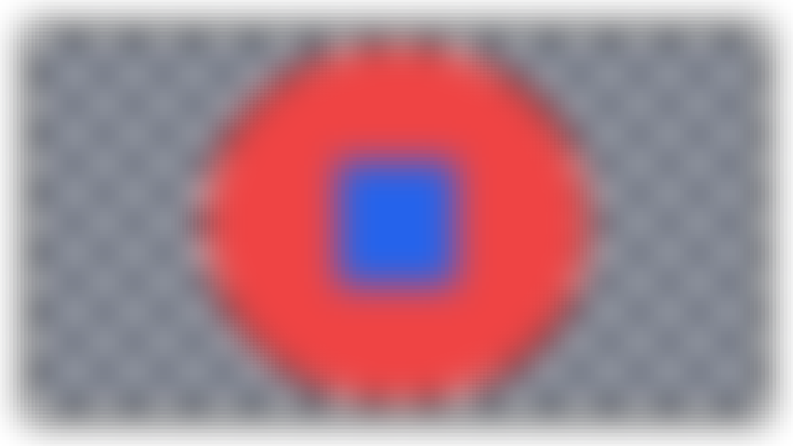
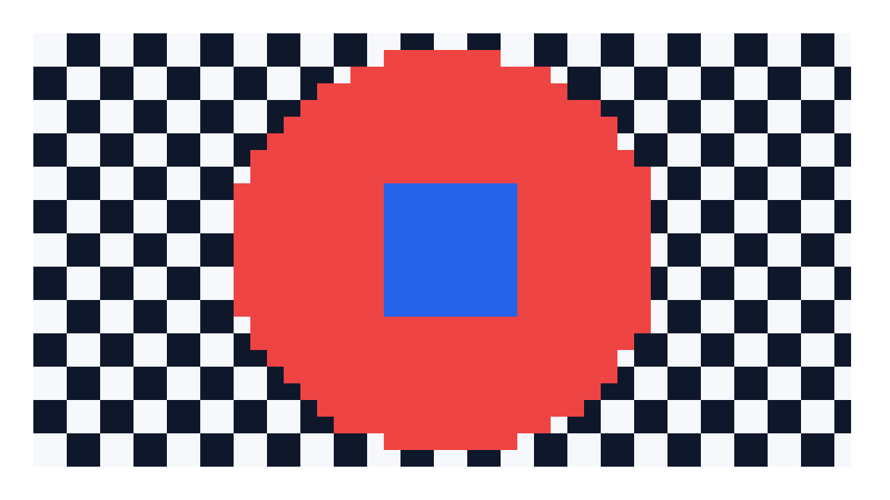

  

<h1 align="center">BlurGo for OBS</h1>

  GPU-accelerated Gaussian blur, Box blur, and Pixelate. 
  One source or a whole nested scene. All inside OBS Studio.

  
  
  
  

  <a href="#download"><b>Download</b></a> ·
  <a href="#quick-start">Quick start</a> ·
  <a href="#see-the-difference">Effects</a> ·
  <a href="docs/README.md">Documentation</a> ·
  <a href="https://github.com/Oceannin/BLURGO/issues/new/choose">Report a bug</a>

## Your scene, with less detail

- **Three looks.** Gaussian for soft edges, Box for a flatter blur, Pixelate for visible blocks.
- **Live controls.** Adjust radius, quality passes, block size, and effect mix in the standard OBS filter panel.
- **Flexible placement.** Filter a single source or an entire composition through a nested scene.
- **Native rendering.** C17 and libobs GPU effects, with English and Russian controls. No browser overlay or separate runtime to install.

## See the difference

Actual BlurGo output from the [0.1.0 acceptance run](docs/qa/0.1.0-manual-signoff.md), using a generated test pattern. Gaussian and Box: radius 12, two passes. Pixelate: block size 16. All effects: 100% mix.

| Original | Gaussian |
| :---: | :---: |
|  |  |
| **Box** | **Pixelate** |
|  |  |

## Download

Requires **OBS Studio 31.1.1 or newer**. Download a package from [the 0.1.0 release](https://github.com/Oceannin/BLURGO/releases/tag/0.1.0), then close OBS before installing.

| Platform | Package | Install |
| --- | --- | --- |
| Windows x64 | [ZIP](https://github.com/Oceannin/BLURGO/releases/download/0.1.0/blurgo-0.1.0-windows-x64.zip) | Extract and copy the `blurgo` folder to `C:\ProgramData\obs-studio\plugins\`. |
| macOS Universal | [PKG](https://github.com/Oceannin/BLURGO/releases/download/0.1.0/blurgo-0.1.0-macos-universal.pkg) | Open the package and follow the installer prompts. |
| Ubuntu 24.04 x86_64 | [DEB](https://github.com/Oceannin/BLURGO/releases/download/0.1.0/blurgo-0.1.0-x86_64-linux-gnu.deb) | Install the downloaded package with your system package manager. |

On Windows, the final DLL path is `C:\ProgramData\obs-studio\plugins\blurgo\bin\64bit\blurgo.dll`. Do not extract this ZIP over the OBS application directory. For other installation layouts, see the [OBS Plugins Guide](https://obsproject.com/kb/plugins-guide).

> **Alpha release.** Back up your scene collection before upgrading. Windows binaries are unsigned; macOS signing/notarization depends on release certificates. Linux and macOS runtime checks used software rendering, so physical-GPU performance on those platforms remains unqualified. See [compatibility and known limitations](docs/release-notes/0.1.0.md).

[All releases and checksums](https://github.com/Oceannin/BLURGO/releases) · [Changelog](CHANGELOG.md) · [Build from source](docs/development.md)

## Quick start

### Blur one source

1. Restart OBS after installation.
2. Right-click a source and open **Filters**.
3. Under **Effect Filters**, select **+ → BlurGo**.
4. Choose **Gaussian**, **Box**, or **Pixelate**, then adjust the visible controls.

### Blur a whole scene

1. Create a wrapper scene.
2. Add your existing scene to it as a **Scene** source.
3. Apply **BlurGo** to that nested scene source.
4. Use the wrapper scene for streaming or recording.

The original scene stays reusable. Avoid nesting a scene inside itself.

| Control | Range | Available in |
| --- | --- | --- |
| Radius | 0–64 | Gaussian, Box |
| Quality passes | 1–4 | Gaussian, Box |
| Pixel block size | 2–256 | Pixelate |
| Effect mix | 0–100% | All modes |

Start with radius **12**, **two passes**, and **100% mix**. Reduce passes first if OBS render time rises. Pixelate uses one processing pass. See [performance guidance](docs/performance.md) for more starting points and measurement limits.

## Troubleshooting

| What you see | What to check |
| --- | --- |
| BlurGo is missing | Confirm the package matches OBS's architecture. Open **Help → Log Files → View Current Log** and look for `[blurgo] loaded successfully` or module-load errors. |
| The image is unchanged | Enable the filter, raise Effect mix above 0%, and use a nonzero blur radius. |
| GPU render time is high | Reduce quality passes or filter a lower-resolution nested scene. |
| Only part of the scene is blurred | Apply BlurGo to the nested Scene source using the wrapper workflow above. |

BlurGo processes the full source; region masks, tracking, and animated transitions are outside the first alpha. Blur is a visual effect, not a guarantee that sensitive information is unrecoverable. Resource failures bypass the effect and may show the original source.

## Build and contribute

Start with the [development guide](docs/development.md) for platform prerequisites, CMake presets, tests, and formatting. The [documentation index](docs/README.md) covers architecture, runtime testing, and release evidence.

[Contributions](CONTRIBUTING.md), focused bug reports, and translations are welcome. For vulnerabilities, follow the private process in [SECURITY.md](SECURITY.md).

## License and credits

BlurGo is free software under [GPL-2.0-or-later](LICENSE). Built on [OBS Studio](https://github.com/obsproject/obs-studio) and the [official OBS plugin template](https://github.com/obsproject/obs-plugintemplate).
